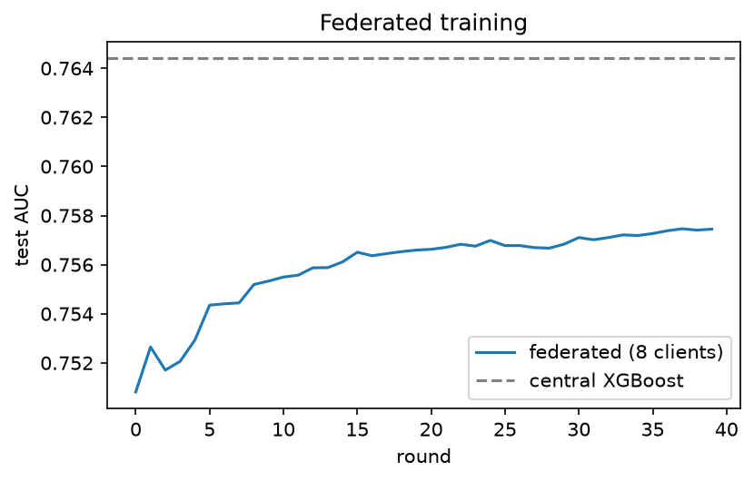

# trustledger

Credit scoring for people without a bank history, built from mobile wallet payments, utility bills and recharges. Every score comes with reasons in Bangla, and approvals are checked for gender and regional bias.

Project For International AI Builders Congress 2026, Daffodil International University, Dhaka By Team Minus One

## Results

| Model | Data | AUC | Notes |
|---|---|---|---|
| TrustLedger | 100,000 simulated Bangladeshi borrowers | 0.764 | approval gap 0.100 → 0.013 |
| TrustLedger, federated | same, 8 divisions as clients | 0.757 | raw data stays on the client |
| Home Credit, alternative data | 307,507 real applicants | 0.703 | 0.693 on applicants with no bureau score |
| Home Credit, bureau scores only | same | 0.725 | 0.667 on applicants with no bureau score |
| LendingClub | 422,373 resolved loans | 0.737 | benchmark |

A typical bank rule (bank account plus salary slip or income ≥ 25,000 BDT) approves 11.7% of borrowers. TrustLedger approves 59.0%, at nearly equal rates across gender and region, and the people it newly includes repay at 83.6%, against 80.6% for those the bank approves (Figures 2 and 3).

No public Bangladeshi wallet dataset exists, so the TrustLedger model is trained on simulated data. Home Credit and LendingClub check the same pipeline on real loans. All numbers are in [`training_files/metrics.json`](training_files/metrics.json).

## Figures

### 1. Bangladesh context

<p align="center">
  
</p>
<p align="center"><b>Figure 1.</b> Account ownership and borrowing in Bangladesh, Global Findex 2025 (survey-weighted, 1,000 adults).</p>

43% of adults have a financial account: 33% of women and 54% of men. 70% borrowed money in the past year from some source. This is the gap TrustLedger targets.

<br>

### 2. Inclusion

<p align="center">
  
</p>
<p align="center"><b>Figure 2.</b> Approval rate by gender and region: traditional bank rule vs TrustLedger.</p>

The bank rule (bank account plus salary slip, or bank account and income ≥ 25,000 BDT) approves 11.7% of borrowers, and about 5% of rural women. TrustLedger approves 59.0%. The 50.3% it newly includes repay at 83.6%, against 80.6% for those the bank approves.

<br>

### 3. Fairness

<p align="center">
  
</p>
<p align="center"><b>Figure 3.</b> Approval rate by gender and region, before and after per-group thresholds.</p>

The model never sees gender or region; they are used only afterwards to set thresholds. The approval gap falls from 0.100 to 0.013 and the equalized-odds gap from 0.097 to 0.034. Balanced accuracy is unchanged (0.694 → 0.691).

<br>

### 4. Model quality

<p align="center">
  
</p>
<p align="center"><b>Figure 4.</b> TrustLedger ROC curve and calibration on the held-out test set (20,000 borrowers).</p>

AUC 0.764, KS 0.390, Brier 0.168. Predicted repayment probabilities match observed rates across all ten bins.

<br>

<p align="center">
  
</p>
<p align="center"><b>Figure 5.</b> Distribution of TrustLedger scores on the test set.</p>

Scores run from 300 to 900. 600 points means 4:1 odds of repayment, and every 50 points doubles the odds.

<br>

### 5. Explanations

<p align="center">
  
</p>
<p align="center"><b>Figure 6.</b> What drives a TrustLedger score (SHAP values, 3,000 test borrowers).</p>

Paying bills on time, a smaller loan relative to income and regular saving raise the score; volatile income lowers it. The two strongest positive and negative factors for each borrower are shown in Bangla with a tip to improve.

<br>

### 6. Federated training

<p align="center">
  
</p>
<p align="center"><b>Figure 7.</b> Test AUC over 40 rounds of federated averaging, with each of the 8 divisions as a client.</p>

Each client trains locally; updates are clipped and noised before averaging, and raw data never leaves the client. The federated model reaches AUC 0.757, against 0.764 for central XGBoost.

<br>

### 7. Real data: Home Credit

<p align="center">
  
</p>
<p align="center"><b>Figure 8.</b> Home Credit AUC by feature set, for all applicants and for applicants with no bureau score.</p>

307,507 real applicants, 11.9% without a bureau score. For those applicants, alternative data alone (AUC 0.693) beats bureau scores alone (0.667). Combining both gives 0.760 overall.

<br>

<p align="center">
  
</p>
<p align="center"><b>Figure 9.</b> Home Credit alternative-data model, ROC curve and calibration.</p>

AUC 0.703, KS 0.299. Calibration is close to the diagonal. With per-group thresholds, the true-positive-rate gap across gender and region falls from 0.402 to 0.018.

<br>

<p align="center">
  
</p>
<p align="center"><b>Figure 10.</b> What drives the Home Credit alternative-data model (SHAP values).</p>

Loan term, years employed, goods-to-credit ratio, regional population density and years on the same phone carry the most weight. No bureau score is used.

<br>

### 8. Real data: LendingClub

<p align="center">
  
</p>
<p align="center"><b>Figure 11.</b> LendingClub benchmark, ROC curve and calibration.</p>

422,373 resolved loans (fully paid or charged off). AUC 0.737, KS 0.347. No gender field, so this is a performance check only.

<br>

## Run

```bash
pip install -r requirements.txt
jupyter nbconvert --to notebook --execute --inplace trustLedger_model_training.ipynb
```

The notebook writes figures and `metrics.json` to `training_files/` and models to `models/`. A missing dataset is skipped; the TrustLedger model always runs.

## Data

All datasets are in `datasets/`. The Kaggle files are stored with [Git LFS](https://git-lfs.com); run `git lfs pull` after cloning.

| File | Source |
|---|---|
| `home-credit-default-risk/application_train.csv` | [Kaggle: Home Credit Default Risk](https://www.kaggle.com/c/home-credit-default-risk) |
| `accepted_2007_to_2018Q4.csv` | [Kaggle: Lending Club](https://www.kaggle.com/datasets/wordsforthewise/lending-club) |
| `Findex_Microdata_2025_updateBangladesh.csv` | [World Bank Global Findex](https://microdata.worldbank.org/catalog/7869) |
