# TrustLedger

**Fair, private, explainable credit scoring for people without a credit history in Bangladesh.**
TrustLedger turns everyday phone habits (wallet payments, utility bills, mobile recharges) into a 300–900 credit score.
Every score comes with reasons in Bangla, and every approval is checked for gender and regional bias.

International AI Builders Congress 2026 · problem **CreditForAll** (FinSphere AI track) · Daffodil International University · **Team Minus One**

| | Link |
|---|---|
| Live demo (API / dashboard) | _set after deployment — see [`docs/deploy.md`](docs/deploy.md)_ |
| Public docs page | [`docs/site/index.html`](docs/site/index.html), served at `/docs` on the dashboard deployment |
| Demo video | _team to add_ |
| Pitch deck | _team to add_ |
| API reference | [`docs/api.md`](docs/api.md) · Swagger at `/docs` on the API |
| Architecture | [`docs/architecture.md`](docs/architecture.md) |
| Privacy | [`docs/privacy.md`](docs/privacy.md) |
| Demo script / judge Q&A | [`docs/DEMO_SCRIPT.md`](docs/DEMO_SCRIPT.md) · [`docs/JUDGE_QA.md`](docs/JUDGE_QA.md) |
| Final status report | [`ALL_FINAL_REPORT.md`](ALL_FINAL_REPORT.md) |

<p align="center">
  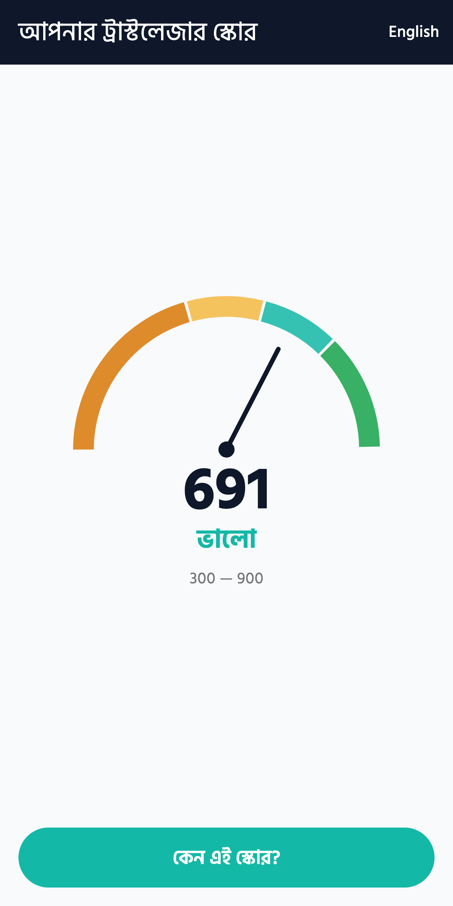
  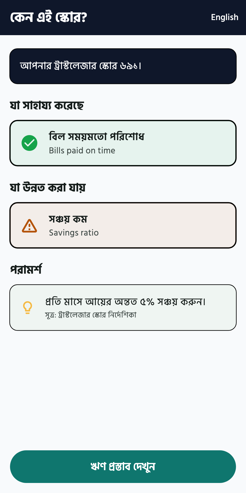
  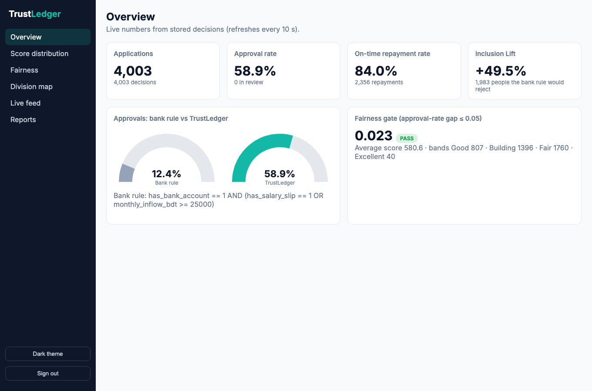
</p>

## Shathi's story

Shathi, 24, works in a garment factory in Ashulia. She has no bank account and no salary slip, but she pays every bill on
time. In the app she grants consent per data source and imports her wallet SMS (which never leave the phone in production)
and one DESCO bill photo (read by DeepSeek-OCR). Five agents then score her **691 (Good)**, approve a 15,000 BDT loan, and
explain why in Bangla ("বিল সময়মতো পরিশোধ", "নিয়মিত মোবাইল রিচার্জ", tip: "প্রতি মাসে আয়ের অন্তত ৫% সঞ্চয় করুন।").
Three on-time repayments raise her limit by 20%. Someone with no wallet history at all gets a first score from **Bhorsha**,
a short Bangla conversation.

## What is in the box

| Part | What it does | Where |
|---|---|---|
| Scoring core | XGBoost P(repay) → 300–900 score, band, SHAP reasons in Bangla, group thresholds | `backend/app/core` |
| Agent pipeline | LangGraph supervisor: Data → Bhorsha router → Scoring → Explainer → Fairness, traced | `backend/app/agents`, `POST /apply` |
| AI layer | DeepSeek chat + DeepSeek-OCR behind one `LLMClient` (offline mock), SMS parser, OCR, Bhorsha | `backend/app/llm`, `parsers`, `bhorsha` |
| RAG | Bangla knowledge base, BM25 + pgvector + reranker, tips cite sources | `backend/app/rag`, `docs/knowledge` |
| API | FastAPI: consent, sessions, apply, score, explain, documents, Bhorsha, loans, fairness, inclusion, dashboard stats, metrics | `backend/app/api` |
| Privacy | Consent per source, Presidio redaction, encrypted 30-day images, delete-my-data, PII-free logs | `backend/app/privacy`, `storage.py` |
| MCP server | `score_user`, `explain_score`, `fairness_audit`, `get_inclusion_lift` (stdio + HTTP) | `mcp_server/` |
| Workflows | Temporal loan lifecycle; Airflow fairness audit, drift, purge, FL round | `workflows/` |
| Federated learning | Flower DP-FedAvg across 8 divisions | `federated/` |
| Borrower app | Flutter, Bangla-first | `apps/mobile` |
| Lender dashboard | React + Recharts + Chart.js + D3 | `apps/dashboard` |
| Evaluations | 8 quality gates run in CI | `evals/` |
| Ops | Docker Compose, Heroku, Prometheus + Grafana, smoke test | `infra/`, `Procfile` |

## Results

| Model | Data | AUC | Notes |
|---|---|---|---|
| TrustLedger | 100,000 simulated Bangladeshi borrowers | 0.764 | KS 0.390, Brier 0.168, ECE 0.006; approval gap 0.100 → 0.013 |
| TrustLedger, Flower DP-FedAvg | same, 8 divisions as clients | 0.756 | notebook FedAvg 0.757; raw data stays on the client |
| Home Credit, alternative data | 307,507 real applicants | 0.703 | 0.693 on applicants with no bureau score |
| Home Credit, bureau scores only | same | 0.725 | 0.667 on applicants with no bureau score |
| LendingClub | 422,373 resolved loans | 0.737 | benchmark |

A typical bank rule (bank account plus salary slip or income ≥ 25,000 BDT) approves **11.7%** of borrowers; TrustLedger approves **59.0%**,
at nearly equal rates across gender and region. The **50.3%** it newly includes repay at **83.6%**, against 80.6% for those the bank approves.

Quality gates (`uv run python evals/run_all.py`, run in CI on every push):

| Gate | Result |
|---|---|
| model auc not below notebook | PASS |
| fairness gaps le 0.05 | PASS |
| sms type f1 ge 0.95 | PASS |
| ocr field f1 ge 0.90 | PASS |
| rag hit rate ge 0.90 | PASS |
| explanations only shap features | PASS |
| bhorsha stable and ordered | PASS |
| prompt regression | PASS |

SMS parser type F1 1.0 (65 fixtures) · RAG context precision 0.95, hit rate 1.0 (30 questions) ·
explanations naming only SHAP features 300/300 · Bhorsha responsible 100.0 vs careless 21.0.
Mock-mode OCR and SMS-fallback numbers measure the pipeline. Live accuracy needs DeepSeek keys (see [`evals/README.md`](evals/README.md)).

No public Bangladeshi wallet dataset exists, so the TrustLedger model is trained on simulated data; Home Credit and
LendingClub check the same pipeline on real loans. All numbers are in [`training_files/metrics.json`](training_files/metrics.json)
and [`training_files/eval_report.json`](training_files/eval_report.json).

## Quick start

Requirements: Python 3.12 + [uv](https://docs.astral.sh/uv/), Docker (optional), Node 20+, Flutter 3.24+.

```bash
uv sync                                   # backend, dev and notebook dependencies
cp .env.example .env                      # defaults run fully offline (LLM_MODE=mock)
export DATABASE_URL=sqlite:///./trustledger.db DEMO_MODE=true API_KEYS=dev-key
make seed                                 # 4 personas + 4,000 synthetic applicants
make ingest                               # RAG knowledge base
make api                                  # http://localhost:8000/docs
infra/smoke.sh http://localhost:8000 dev-key   # Shathi's full flow
```

With Postgres + pgvector, Redis, MinIO and Temporal: `make compose-up`, then `uv run alembic upgrade head`.

| Run | Command |
|---|---|
| Tests, lint, types | `make test` · `make lint` |
| Evaluations + gates | `uv run python evals/run_all.py` |
| Lender dashboard | `cd apps/dashboard && npm install && npm run dev` (docs site at `/docs`) |
| Borrower app | `cd apps/mobile && flutter run` (`--dart-define=API_BASE_URL=http://10.0.2.2:8000` on Android emulator) |
| MCP server | `make mcp` (stdio) · `MCP_API_KEYS=k make mcp-http` |
| Loan workflow | `uv run python -m workflows.temporal.worker` + `uv run python -m workflows.temporal.cli start --persona shathi` |
| Federated learning | `uv run python -m federated.simulate` |
| Monitoring | `docker compose -f infra/docker-compose.yml --profile monitoring up -d` → Grafana :3000 |
| Deploy | [`docs/deploy.md`](docs/deploy.md) |

## Repository layout

```
backend/app/       core · agents · api · bhorsha · db · llm · parsers · privacy · rag · services · storage · observability
backend/tests/     pytest suite (offline, mock LLM)
backend/alembic/   migrations (pgvector)
apps/mobile/       Flutter borrower app          apps/dashboard/   React lender dashboard
mcp_server/        MCP server                     workflows/        Temporal + Airflow
federated/         Flower                          evals/            evaluation suites + gates
models/            production model + metadata    training_files/   figures + metrics
docs/              plan, prompts, reports, architecture, API, privacy, knowledge base, docs site, media
infra/             Docker, Heroku scripts, Prometheus, Grafana, smoke test
trustLedger_model_training.ipynb   training notebook
```

## The training notebook

`trustLedger_model_training.ipynb` trains and evaluates every model and writes the artifacts the API loads:

| Section | Output |
|---|---|
| Global Findex Bangladesh (2025 microdata) | inclusion baseline, Figure 1 |
| Home Credit (real, 307,507 applicants) | alternative vs bureau data, fairness thresholds, Figures 8–10, `models/homecredit_*` |
| LendingClub (real, 422,373 loans) | benchmark, Figure 11, `models/lendingclub_xgb.json` |
| Synthetic Bangladesh borrowers (100,000) | generator → `datasets/trustledger_synthetic_bd.csv`, 60/20/20 split (seed 42) |
| TrustLedger XGBoost | **`models/trustledger_xgb.json`** (production), score scale, Figures 4–5 |
| SHAP | Bangla reasons and tips → **`models/trustledger_meta.json`**, Figure 6 |
| Fairness | per-group thresholds (`group_thresholds` in meta), Figure 3 |
| Inclusion lift | bank rule vs TrustLedger, Figure 2 |
| Federated (FedAvg) | `models/federated_weights.npy`, Figure 7 (rebuilt with Flower in `federated/`) |

Model contract (code reads everything from `trustledger_meta.json`; retraining changes only `models/`):
features `monthly_inflow_bdt, income_volatility, months_on_wallet, txn_per_month, bills_on_time, recharge_regularity,
savings_ratio, sends_money_home, bhorsha_score, loan_to_income` (missing allowed); score `600 + 50/ln2 · ln((p/(1−p))/4)`
clipped to 300–900; bands Excellent ≥ 750, Good ≥ 650, Fair ≥ 550, Building.

Run it:

```bash
uv sync                                   # includes the notebook group (jupyter, matplotlib)
uv run jupyter nbconvert --to notebook --execute --inplace trustLedger_model_training.ipynb
# or with pip: pip install -r requirements-notebook.txt
```

A missing dataset is skipped; the TrustLedger model always runs (it generates its own synthetic data).

### Figures

#### 1. Bangladesh context

<p align="center">
  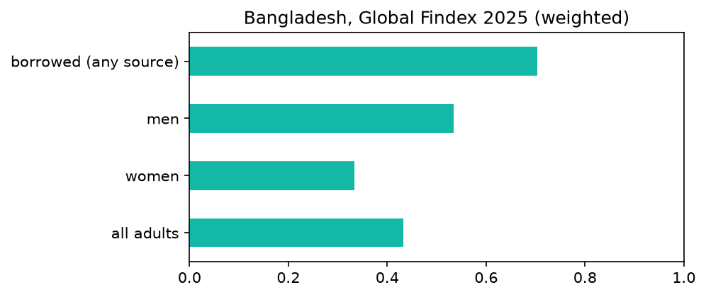
</p>
<p align="center"><b>Figure 1.</b> Account ownership and borrowing in Bangladesh, Global Findex 2025 (survey-weighted, 1,000 adults).</p>

43% of adults have a financial account: 33% of women and 54% of men. 70% borrowed money in the past year from some source. This is the gap TrustLedger targets.

<br>

#### 2. Inclusion

<p align="center">
  
</p>
<p align="center"><b>Figure 2.</b> Approval rate by gender and region: traditional bank rule vs TrustLedger.</p>

The bank rule (bank account plus salary slip, or bank account and income ≥ 25,000 BDT) approves 11.7% of borrowers, and about 5% of rural women. TrustLedger approves 59.0%. The 50.3% it newly includes repay at 83.6%, against 80.6% for those the bank approves.

<br>

#### 3. Fairness

<p align="center">
  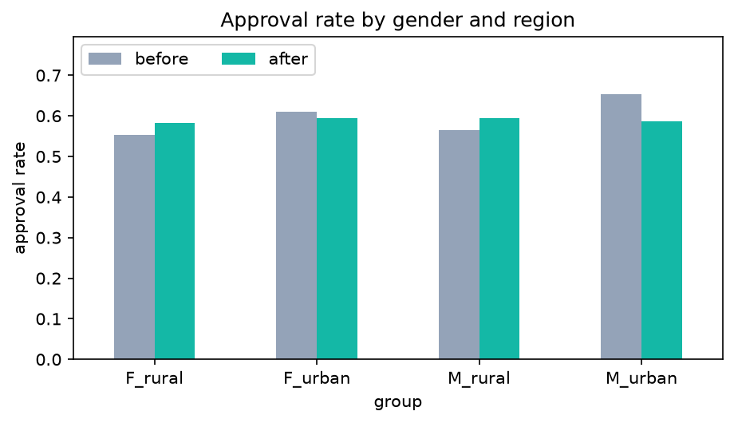
</p>
<p align="center"><b>Figure 3.</b> Approval rate by gender and region, before and after per-group thresholds.</p>

The model never sees gender or region; they are used only afterwards to set thresholds. The approval gap falls from 0.100 to 0.013 and the equalized-odds gap from 0.097 to 0.034. Balanced accuracy is unchanged (0.694 → 0.691).

<br>

#### 4. Model quality

<p align="center">
  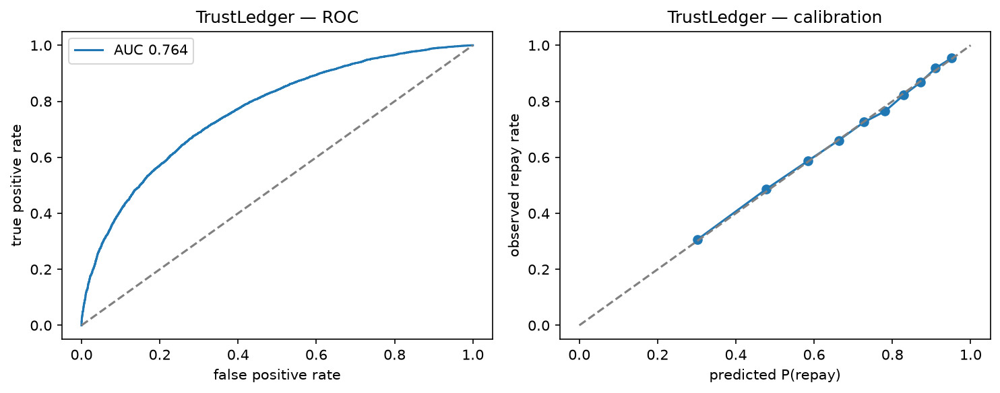
</p>
<p align="center"><b>Figure 4.</b> TrustLedger ROC curve and calibration on the held-out test set (20,000 borrowers).</p>

AUC 0.764, KS 0.390, Brier 0.168. Predicted repayment probabilities match observed rates across all ten bins.

<br>

<p align="center">
  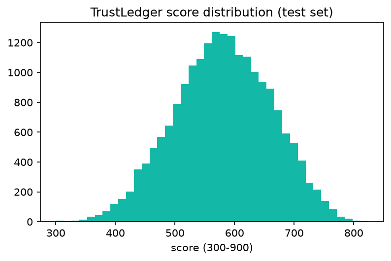
</p>
<p align="center"><b>Figure 5.</b> Distribution of TrustLedger scores on the test set.</p>

Scores run from 300 to 900. 600 points means 4:1 odds of repayment, and every 50 points doubles the odds.

<br>

#### 5. Explanations

<p align="center">
  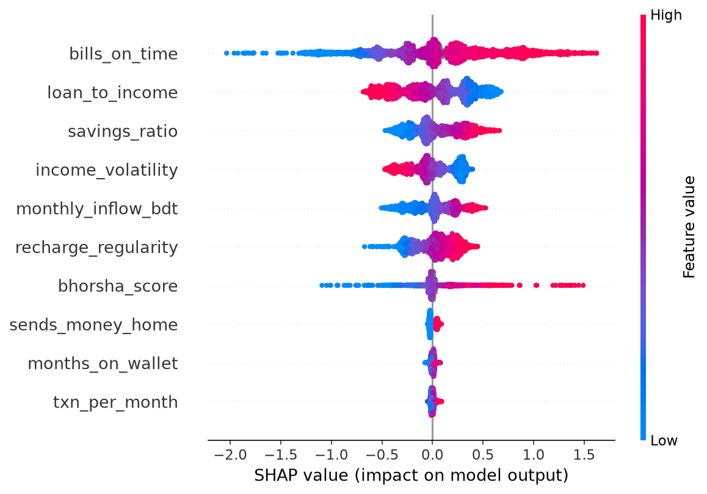
</p>
<p align="center"><b>Figure 6.</b> What drives a TrustLedger score (SHAP values, 3,000 test borrowers).</p>

Paying bills on time, a smaller loan relative to income and regular saving raise the score; volatile income lowers it. The two strongest positive and negative factors for each borrower are shown in Bangla with a tip to improve.

<br>

#### 6. Federated training

<p align="center">
  
</p>
<p align="center"><b>Figure 7.</b> Test AUC over 40 rounds of federated averaging, with each of the 8 divisions as a client.</p>

Each client trains locally; updates are clipped and noised before averaging, and raw data never leaves the client. The federated model reaches AUC 0.757, against 0.764 for central XGBoost.

<br>

#### 7. Real data: Home Credit

<p align="center">
  
</p>
<p align="center"><b>Figure 8.</b> Home Credit AUC by feature set, for all applicants and for applicants with no bureau score.</p>

307,507 real applicants, 11.9% without a bureau score. For those applicants, alternative data alone (AUC 0.693) beats bureau scores alone (0.667). Combining both gives 0.760 overall.

<br>

<p align="center">
  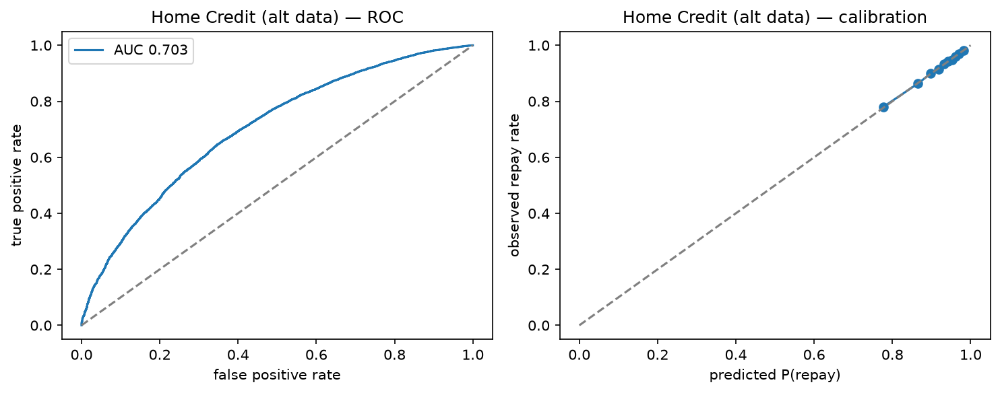
</p>
<p align="center"><b>Figure 9.</b> Home Credit alternative-data model, ROC curve and calibration.</p>

AUC 0.703, KS 0.299. Calibration is close to the diagonal. With per-group thresholds, the true-positive-rate gap across gender and region falls from 0.402 to 0.018.

<br>

<p align="center">
  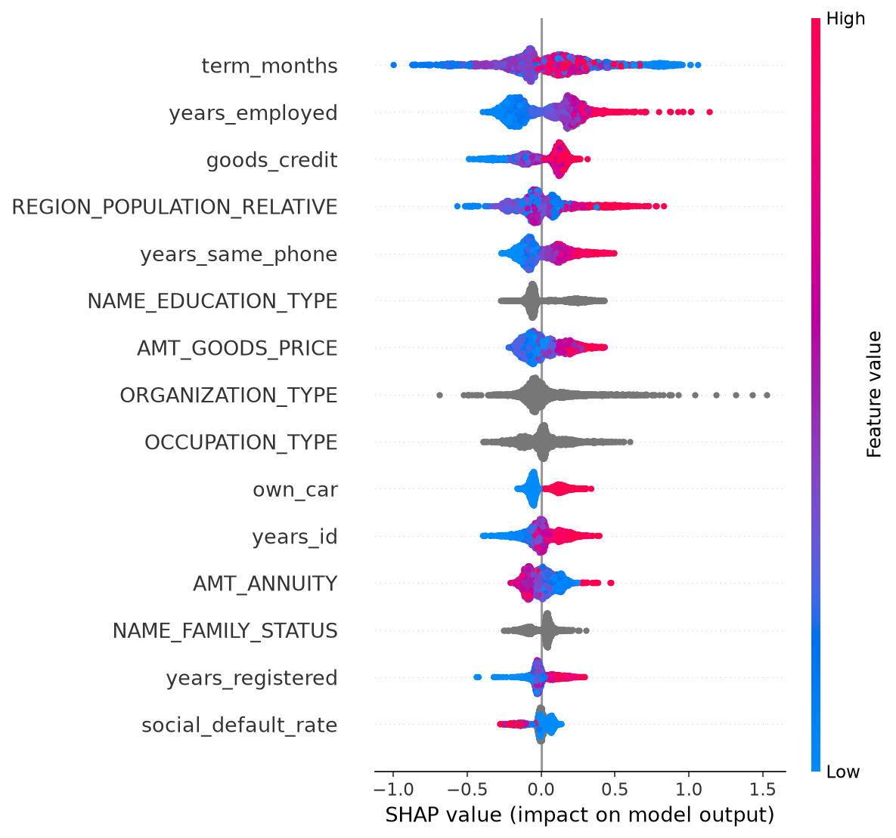
</p>
<p align="center"><b>Figure 10.</b> What drives the Home Credit alternative-data model (SHAP values).</p>

Loan term, years employed, goods-to-credit ratio, regional population density and years on the same phone carry the most weight. No bureau score is used.

<br>

#### 8. Real data: LendingClub

<p align="center">
  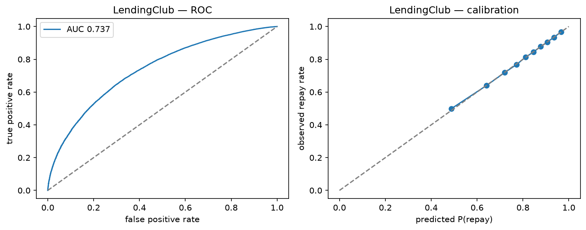
</p>
<p align="center"><b>Figure 11.</b> LendingClub benchmark, ROC curve and calibration.</p>

422,373 resolved loans (fully paid or charged off). AUC 0.737, KS 0.347. No gender field, so this is a performance check only.

<br>


## Data

`datasets/` is git-ignored (several GB). Download the public files into it before running the notebook:

| File | Source |
|---|---|
| `home-credit-default-risk/application_train.csv` (+ other tables) | [Kaggle: Home Credit Default Risk](https://www.kaggle.com/c/home-credit-default-risk) |
| `accepted_2007_to_2018Q4.csv` | [Kaggle: Lending Club](https://www.kaggle.com/datasets/wordsforthewise/lending-club) |
| `Findex_Microdata_2025_updateBangladesh.csv` | [World Bank Global Findex](https://microdata.worldbank.org/catalog/7869) |
| `trustledger_synthetic_bd.csv` | generated by the notebook (the CI test split is committed at `evals/data/test_split.csv.gz`) |

No real personal data is used anywhere; personas, SMS and bills in the repo are synthetic.

## Team Minus One

Dipanwita Maitra (Team Lead, Voiceover & Scripting) · Prayangshu Biswas (Video Editor, Co-Developer & AI/ML Engineer) ·
Daniel (Lead Developer) · Soniya (Researcher & UI/UX) · Fariha (Documentation & Co-Research)

Build history: [`docs/PROMPT.md`](docs/PROMPT.md) and one report per step in `docs/PROMPT*_REPORT.md`.
