# TrustLedger

**Fair, private, and explainable alternative credit scoring for Bangladesh's unbanked.**

TrustLedger transforms everyday digital phone habits (mobile wallet transactions, utility bill payments, and recharge regularity) into a transparent **300–900 credit score**. Every decision is explained with actionable reasons in **Bangla**, and every approval is audited to eliminate **gender and regional bias**.

[](https://github.com/prayangshuuu/trustLedger/actions/workflows/ci.yml)


*International AI Builders Congress 2026 · Problem: **CreditForAll** (FinSphere AI Track) · Daffodil International University*

---

## Results at a Glance

| Metric | Traditional Bank Rule | TrustLedger | Impact |
|:---|:---:|:---:|:---|
| **Overall Approval Rate** | 11.7% | **59.0%** | **+47.3%** inclusion lift |
| **Rural Women Approval Rate** | ~5.0% | **58.2%** | Eliminates acute financial exclusion |
| **Approval Gap (Gender × Region)** | 0.100 | **0.013** | **87% gap reduction** across demographic groups |
| **Equalized Odds Difference** | 0.097 | **0.034** | Strict demographic parity and fair opportunity |
| **Repayment Rate (Newly Included)** | 80.6% *(bank-approved)* | **83.6%** | Higher repayment reliability than traditional criteria |
| **Model Discrimination** | — | **0.764 AUC** | KS: 0.390 · Brier: 0.168 · ECE: 0.006 |
| **Privacy-Preserving Federated AUC** | — | **0.756 AUC** | 8 administrative divisions via Flower DP-FedAvg |
| **CI Quality Gates** | — | **9 / 9 Pass** | Automated regression, fairness, and quality suites |

---

## The Problem & Moon's Story

In Bangladesh, only **43% of adults** hold a formal financial account (**33% of women** vs. 54% of men, *Global Findex 2025*). Yet over **70%** borrow money regularly—often forced to rely on informal, high-interest moneylenders because commercial banks require formal pay slips, tax returns, and credit bureau (CIB) records.

> **Meet Moon:** A 24-year-old garment worker in Ashulia. She earns a consistent income and pays all utility bills on time through mobile financial services (bKash/Nagad), but lacks a formal salary slip or traditional bank account.
>
> 1. **Granular Consent:** In the TrustLedger app, Moon grants selective consent for wallet transaction history and uploads a DESCO utility bill photo.
> 2. **Privacy-Preserving Analysis:** SMS messages are parsed client-side (raw SMS never leave the device), and the bill photo is parsed via OCR.
> 3. **Fair Evaluation:** The multi-agent pipeline scores her **691 (Good)** and qualifies her for a **15,000 BDT** micro-loan.
> 4. **Bangla Explanations & Actionable Advice:** She receives transparent explanations in native Bangla (*"বিল সময়মতো পরিশোধ"*, *"নিয়মিত মোবাইল রিচার্জ"*) along with a personalized financial tip: *"প্রতি মাসে আয়ের অন্তত ৫% সঞ্চয় করুন।"*
> 5. **Thin-File Support:** Applicants without mobile wallet history converse with **Bhorsha**, an interactive conversational agent that assesses financial habits fairly.

---

## Product Previews

### Borrower Mobile App (Flutter · Bangla-First)

| 1. Granular Consent | 2. Transparent Score | 3. Bangla Explanations |
|:---:|:---:|:---:|
| 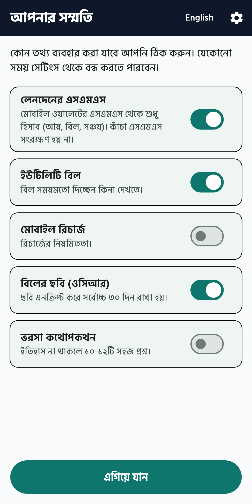 |  |  |
| Explicit consent per data source.<br>Raw SMS is never stored. | Transparent 300–900 gauge,<br>rating band, and loan limit. | SHAP-derived positive/negative factors<br>with source-cited financial tips. |

### Lender & Risk Dashboard (React + Vite + D3)

| Portfolio & Inclusion Overview | Live Demographic Parity & Fairness Auditing |
|:---:|:---:|
|  | 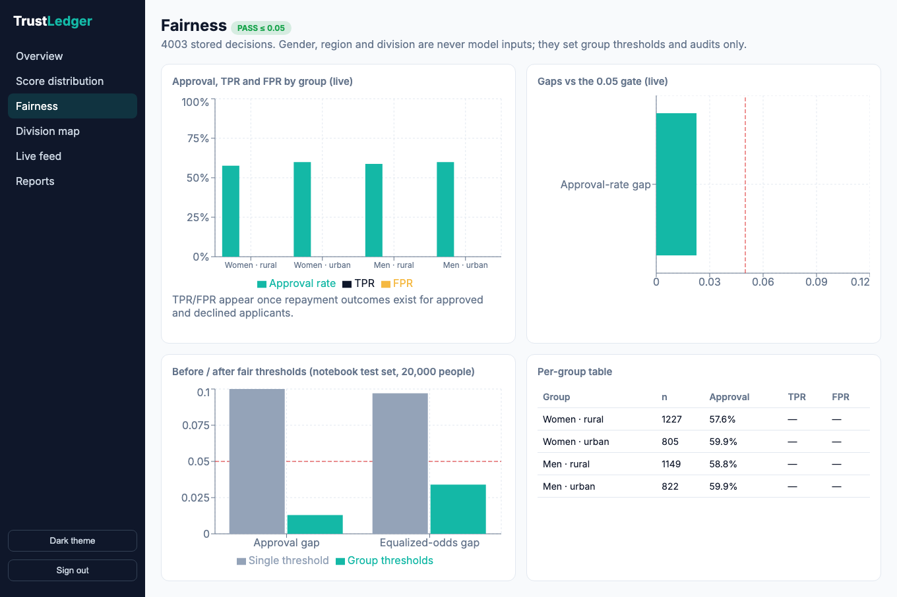 |
| Real-time approval rates, volume metrics, and inclusion lift against standard bank criteria. | Live approval parity tracking across gender and region against the 0.05 CI fairness gate. |

<details>
<summary><b>View Additional Dashboard Views (Division Map, Score Distribution, Grafana API Monitoring)</b></summary>

<br>

| Geographic Distribution (D3) | Score Distribution |
|:---:|:---:|
| 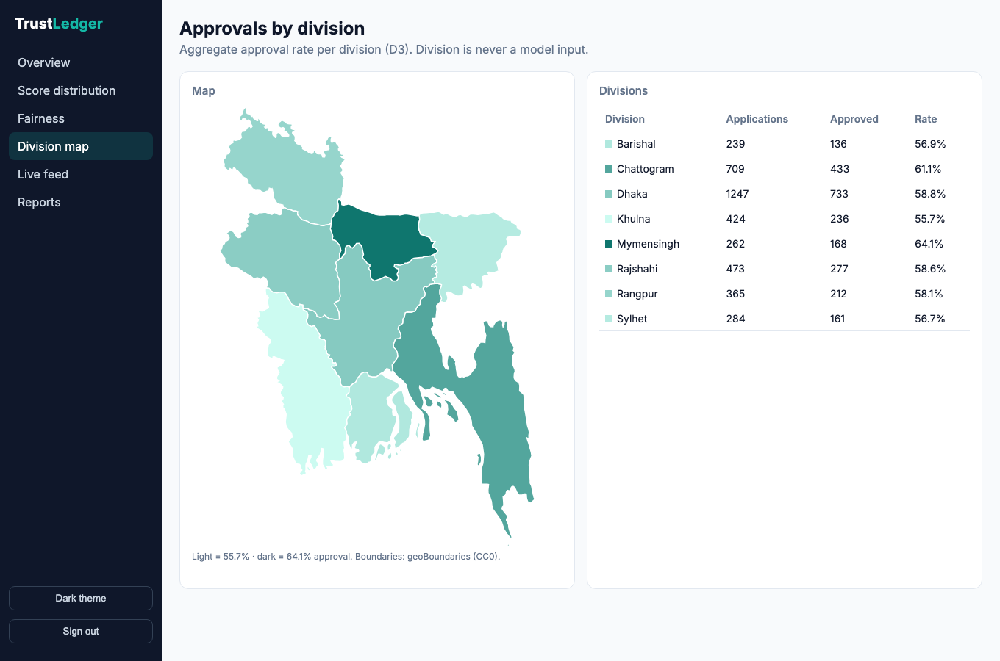 | 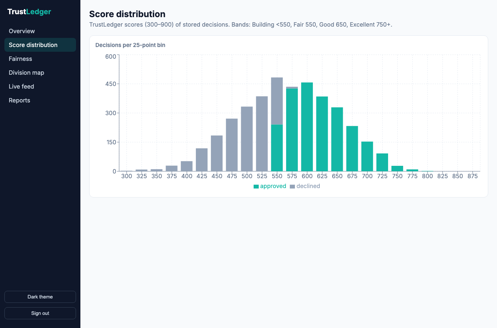 |
| Division-level approval monitoring (55.7%–64.1%). Division is never a model input. | Stored decisions per 25-point bin with approved vs. declined counts. |

| Modern Dark Theme | Prometheus & Grafana Observability |
|:---:|:---:|
| 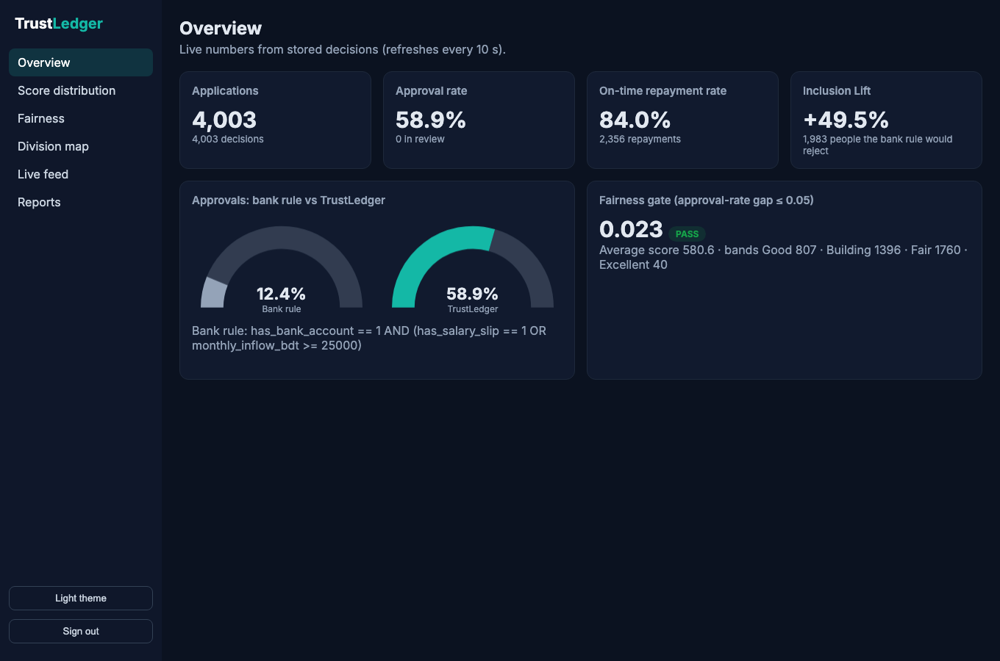 | 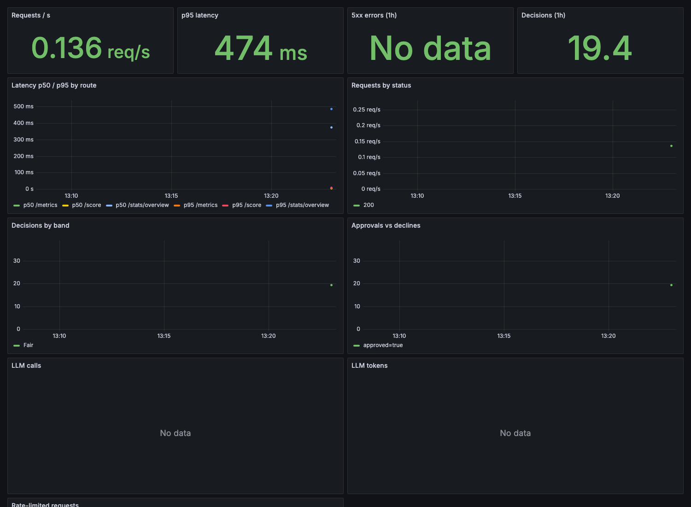 |
| Comprehensive dark mode support across all screens. | Latency percentiles (p50/p95), endpoint throughput, token usage. |

**Live Decision Audit Feed:**

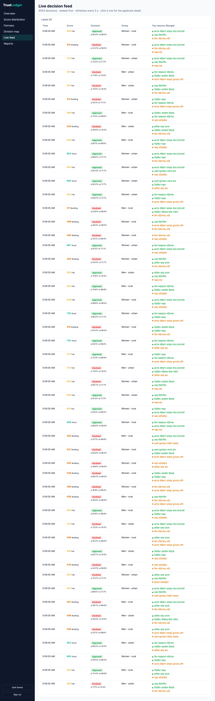

*Real-time stream of evaluated decisions with localized Bangla SHAP factors for each applicant.*

</details>

---

## How It Works

### Multi-Agent Scoring Pipeline

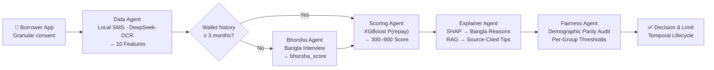

The scoring workflow is orchestrated via **LangGraph** behind `POST /apply`. Sensitive demographic attributes (gender, division, and region) are **strictly excluded from model features**; they are utilized exclusively by the post-scoring Fairness Agent to enforce equal opportunity thresholds and audit against bias.

### System Architecture

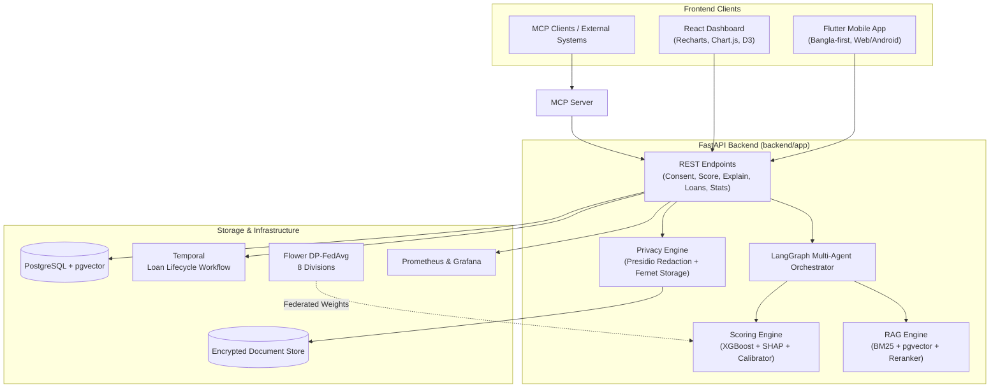

---

## Quick Start

### Prerequisites
- **Python 3.12+** and [**uv**](https://docs.astral.sh/uv/)
- **Node.js 20+** and **npm**
- **Flutter 3.24+** *(optional, for mobile/web client)*
- **Docker** *(optional, for full compose stack)*

### Local Setup in 4 Steps

```bash
# 1. Install Python dependencies and tools
uv sync

# 2. Configure environment (runs fully offline by default with deterministic mocks)
cp .env.example .env
export DATABASE_URL=sqlite:///./trustledger.db DEMO_MODE=true API_KEYS=dev-key

# 3. Initialize SQLite database, seed 4 personas & 4,000 applicants, and ingest RAG docs
make seed
make ingest

# 4. Start the FastAPI backend
make api
# Backend API available at: http://localhost:8000/api/docs
```

Verify Moon's end-to-end evaluation with the automated smoke test:
```bash
infra/smoke.sh http://localhost:8000 dev-key
```

### Common Commands

| Task | Command | Description |
|---|---|---|
| **Run Tests** | `make test` | Executes backend test suite with 93% code coverage |
| **Lint & Format** | `make lint` | Validates Ruff styling and Mypy strict typing |
| **Quality Gates** | `uv run python evals/run_all.py` | Runs all 9 automated model and CI quality gates |
| **Lender Dashboard** | `cd apps/dashboard && npm install && npm run dev` | Runs the React dashboard on `http://localhost:5173` |
| **Borrower App** | `cd apps/mobile && flutter run` | Runs Flutter on Chrome, macOS desktop, or Android |
| **MCP Server** | `make mcp` *(stdio)* · `make mcp-http` *(HTTP)* | Starts Model Context Protocol server for LLM tools |
| **Federated Simulation** | `uv run python -m federated.simulate` | Simulates DP-FedAvg training across 8 divisions |
| **Full Compose Stack** | `make compose-up` | Starts Postgres, pgvector, Redis, MinIO, and Temporal |

---

## The AI Scoring Model

### Alternative Data Features (10)
Sensitive protected attributes (gender, religion, geographic division) are **never model inputs**. The scoring model relies exclusively on 10 behavioral and cash-flow indicators:

| Feature | Description | Impact When Favorable (Bangla) | Impact When Unfavorable (Bangla) |
|---|---|---|---|
| `monthly_inflow_bdt` | Average monthly wallet deposits | মাসিক আয় ভালো | মাসিক আয় কম |
| `income_volatility` | Month-to-month cash flow variation | আয় স্থিতিশীল | আয় অনিয়মিত |
| `months_on_wallet` | Account history tenure (months) | দীর্ঘ ওয়ালেট ইতিহাস | ওয়ালেট ইতিহাস কম |
| `txn_per_month` | Monthly transaction frequency | নিয়মিত লেনদেন | লেনদেন কম |
| `bills_on_time` | Ratio of utility bills paid by due date | বিল সময়মতো পরিশোধ | বিল পরিশোধে দেরি |
| `recharge_regularity` | Mobile top-up consistency | নিয়মিত মোবাইল রিচার্জ | রিচার্জ অনিয়মিত |
| `savings_ratio` | Wallet balance accumulation rate | নিয়মিত সঞ্চয় | সঞ্চয় কম |
| `sends_money_home` | Regular remittance to rural family | নিয়মিত পরিবারে টাকা পাঠান | রেমিট্যান্স অনিয়মিত |
| `bhorsha_score` | Thin-file conversational interview (0–100) | ভরসা মূল্যায়নে ভালো ফল | ভরসা মূল্যায়নে উন্নতি দরকার |
| `loan_to_income` | Requested loan relative to monthly income | ঋণের পরিমাণ আয়ের সাথে মানানসই | ঋণের পরিমাণ আয়ের তুলনায় বেশি |

### Scoring & Calibration
- **Algorithm:** XGBoost (`hist` tree method, Youden's J decision threshold $P(\text{repay}) \ge 0.705$).
- **Score Scale:** Mapped to 300–900 using log-odds scaling:
  $$\text{Score} = 600 + \frac{50}{\ln 2} \cdot \ln \left( \frac{p / (1 - p)}{4} \right)$$
  *(600 points corresponds to 4:1 odds of on-time repayment; every 50-point increase doubles the odds).*
- **Score Tiers:** **Excellent** (≥ 750), **Good** (≥ 650), **Fair** (≥ 550), **Building** (< 550).
- **Federated Training:** Evaluated across 8 division clients using Flower DP-FedAvg (AUC 0.756), ensuring user training data never leaves its region.

<details>
<summary><b>View Research & Model Training Figures (11 Evaluation Plots)</b></summary>

<br>

| Figure 1: Bangladesh Financial Context | Figure 2: Inclusion Lift |
|:---:|:---:|
| <br>Account ownership and borrowing in Bangladesh (Global Findex 2025). | 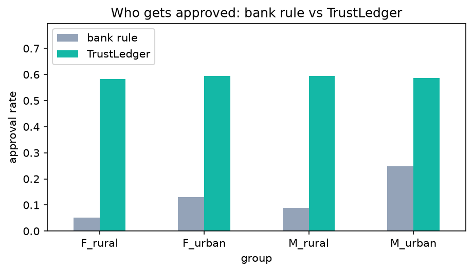<br>Approval rate by group: Bank rule vs. TrustLedger. |

| Figure 3: Fairness Calibration | Figure 4: ROC & Calibration |
|:---:|:---:|
| <br>Approval rate before and after per-group thresholds (0.100 → 0.013). | <br>ROC curve (AUC 0.764) and test calibration curve (ECE 0.0057). |

| Figure 5: Score Distribution | Figure 6: Global SHAP Factors |
|:---:|:---:|
| <br>Distribution of 300–900 credit scores across 20,000 test borrowers. | <br>Global SHAP feature importance driving credit decisions. |

| Figure 7a: Notebook FedAvg | Figure 7b: Flower DP-FedAvg |
|:---:|:---:|
| <br>Centralized vs. Federated simulation over 40 rounds (AUC 0.757). | 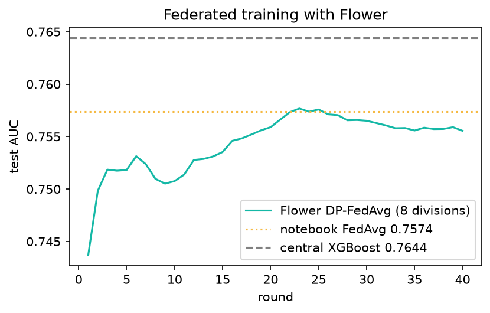<br>Flower DP-FedAvg convergence across 8 divisions (AUC 0.756). |

| Figure 8: Home Credit Benchmark | Figure 9: Home Credit Calibration |
|:---:|:---:|
| 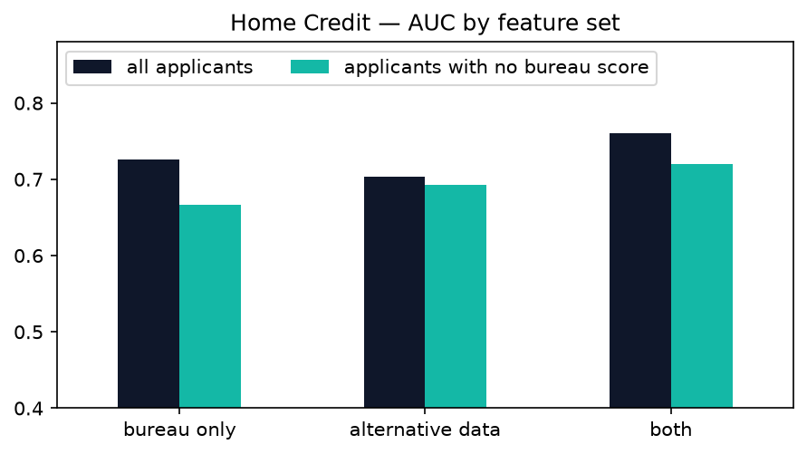<br>Alternative data (0.693) outperforms bureau data (0.667) for thin files. | <br>Calibration curve on 307,507 real applicants. |

| Figure 10: LendingClub Benchmark |
|:---:|
| <br>Validation across 422,373 resolved loans (AUC 0.737). |

</details>

---

## Automated Quality Gates & CI

Every build and pull request is audited against 9 strict quality gates via `uv run python evals/run_all.py`:

| # | Quality Gate | Target / Threshold | Observed Result | Status |
|:---:|---|:---:|:---:|:---:|
| 1 | **Model Discrimination** | Held-out Test AUC ≥ 0.7644 | **0.7644** | ✅ PASS |
| 2 | **Demographic Parity Gap** | Approval rate gap ≤ 0.05 | **0.0131** | ✅ PASS |
| 3 | **Equalized Odds Gap** | TPR/FPR gap ≤ 0.05 | **0.0340** | ✅ PASS |
| 4 | **Independent Fairlearn Audit** | Demographic Parity Diff ≤ 0.05 | **0.0132** | ✅ PASS |
| 5 | **SMS Parsing Accuracy** | Classification F1 ≥ 0.95 | **1.000** | ✅ PASS |
| 6 | **Document OCR Accuracy** | Field extraction F1 ≥ 0.90 | **1.000** | ✅ PASS |
| 7 | **RAG Retrieval Quality** | Knowledge hit rate ≥ 0.90 | **1.000** (Precision 0.95) | ✅ PASS |
| 8 | **Faithful SHAP Explanations** | Explanations match verified factors | **300 / 300** (100%) | ✅ PASS |
| 9 | **Bhorsha Conversation Consistency** | Responsible score > Careless score | **100.0 vs. 21.0** | ✅ PASS |

---

## Privacy, Security & Responsible AI

- **Granular Consent:** Borrowers select which data sources to share (SMS, utility bills, recharges). Consent is revocable at any time.
- **Client-Side SMS Processing:** Raw SMS messages are parsed entirely on the borrower's device; only aggregated numerical features are transmitted.
- **Encrypted Document Storage & Automated Purge:** Bill photos and proof documents are Fernet-encrypted and automatically purged after 30 days. Full compliance with `DELETE /me` erases all user profile records, files, and credit decisions.
- **PII Redaction:** Microsoft Presidio automatically redacts personal identifiable information (names, mobile numbers, NID numbers) before any prompt reaches an LLM.
- **Protected Attributes Never Scored:** Gender, religion, and location are never inputs to the model. They are used post-scoring to guarantee equal approval opportunities across demographic groups.

---

## Repository Layout

```
trustledger/
├── apps/
│   ├── mobile/             # Flutter borrower app (Bangla-first, Web & Android)
│   └── dashboard/          # React + Vite lender dashboard (Recharts, Chart.js, D3)
├── backend/
│   ├── app/                # FastAPI backend: agents, core ML, API routers, RAG, privacy
│   ├── alembic/            # Database schema migrations (pgvector)
│   └── tests/              # Backend test suite (190+ unit and integration tests)
├── mcp_server/             # Model Context Protocol (MCP) server (stdio and HTTP)
├── evals/                  # Evaluation scripts, golden test fixtures, and CI quality gates
├── federated/              # Flower DP-FedAvg multi-division simulation
├── workflows/              # Temporal loan lifecycle workflows and Airflow DAGs
├── models/                 # Serialized XGBoost models and threshold metadata
├── training_files/         # Research figures, evaluation metrics, and benchmark logs
├── docs/                   # System architecture, API specs, privacy model, deploy guides
└── infra/                  # Docker Compose, Prometheus, Grafana, and smoke tests
```

---

## Documentation & Resources

- [System Architecture Specification](docs/architecture.md)
- [API Reference & OpenAPI Schema](docs/api.md)
- [Privacy, Data Governance & Security Architecture](docs/privacy.md)
- [Comprehensive Model Evaluation Report](evals/EVAL_REPORT.md)
- [Deployment Guide (Heroku, Docker, Cloud)](docs/deploy.md)
- [Hackathon Demo Presentation Script](docs/DEMO_SCRIPT.md)
- [Judge Technical Q&A Cheat Sheet](docs/JUDGE_QA.md)
