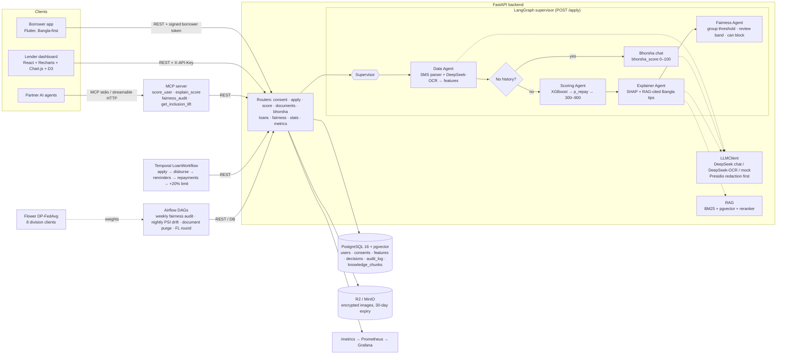

# Architecture

## Request path: Moon applies

1. **Consent.** The app records one consent per source (`/consent`). Every later step checks it.
2. **Data Agent.** In the demo, raw SMS goes to `/apply` and is parsed in memory (regex first, then a PII-redacted DeepSeek fallback). Bill photos were already read by DeepSeek-OCR via `/documents`. Only the 10 derived features are stored.
3. **Bhorsha router.** Under 3 months of wallet history and no `bhorsha_score` → status `bhorsha_required`. The app then runs the 12-question Bangla chat.
4. **Scoring Agent.** XGBoost predicts `p_repay`, mapped to 300–900 (600 = 4:1 odds, +50 doubles the odds) and a band.
5. **Explainer Agent.** It takes the top-2 positive and negative SHAP reasons (|impact| ≥ 0.02, non-missing) in Bangla, adds tips that each cite one knowledge-base source, and writes an LLM summary that is rejected if it names any non-SHAP feature.
6. **Fairness Agent.** It applies the group threshold (`F_rural`, `F_urban`, `M_rural`, `M_urban`), checks that no sensitive input reached the model, and blocks on any failure. Cases within ±0.03 of the threshold go to `needs_review`.
7. **Finalize.** The decision and a complete audit entry (features, reasons, threshold, checks, model and prompt versions, node timings) are written. `trace_id` is returned.

Gender, region, division and age are never model inputs. They only choose the threshold and feed audits.

## Components and files

| Component | Code |
|---|---|
| Scoring core (pure, no I/O) | `backend/app/core/` |
| Agents + versioned prompts | `backend/app/agents/` |
| LLM gateway, mocks | `backend/app/llm/client.py` |
| SMS parser, feature builder, OCR | `backend/app/parsers/` |
| Bhorsha | `backend/app/bhorsha/` |
| RAG | `backend/app/rag/`, `docs/knowledge/` |
| Privacy (consent, deletion, Presidio) | `backend/app/privacy/`, `backend/app/storage.py` |
| Observability, rate limits | `backend/app/observability.py`, `infra/grafana/` |
| MCP | `mcp_server/` |
| Temporal, Airflow | `workflows/` |
| Federated learning | `federated/` |
| Apps | `apps/mobile/`, `apps/dashboard/` |
| Evaluations | `evals/` |
| Training | `trustLedger_model_training.ipynb` → `models/`, `training_files/` |
